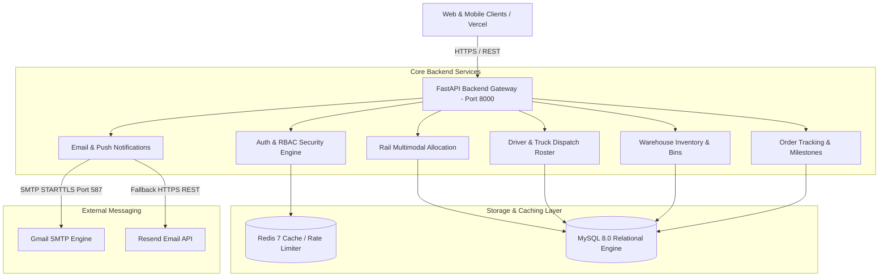
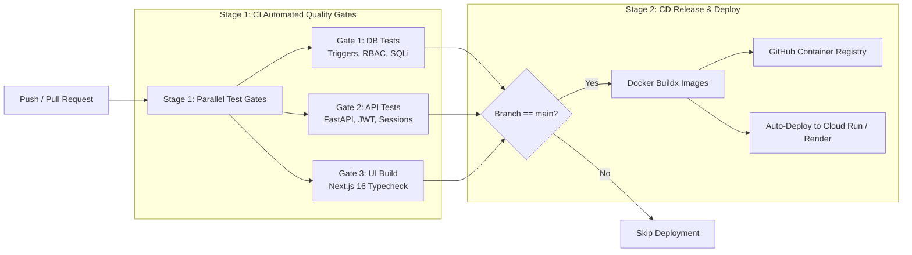

# 🚂 KandyPack Supply Chain & Logistics Backend API

Enterprise-grade multimodal freight scheduling, inventory management, and last-mile dispatch platform. Built with **FastAPI**, **Python 3.10+**, **MySQL 8.0**, **Redis 7**, and **Docker**.

---

## 📑 Table of Contents
1. [System Architecture](#-system-architecture)
2. [Prerequisites & Environment Variables](#-prerequisites--environment-variables)
3. [Local Development & Docker Setup](#-local-development--docker-setup)
4. [Email Transmission Architecture & Triggers](#-email-transmission-architecture--triggers)
5. [CI/CD Pipeline Architecture](#-cicd-pipeline-architecture)
6. [Complete REST API Reference](#-complete-rest-api-reference)
   - [Authentication & Identity (Feature 4.1)](#1-authentication--identity-feature-41)
   - [Customer Orders & Live Tracking](#2-customer-orders--live-tracking)
   - [Multimodal Rail Freight Allocation (Feature 4.2)](#3-multimodal-rail-freight-allocation-feature-42)
   - [Last-Mile Truck Roster & Driver Dispatch (Feature 4.3)](#4-last-mile-truck-roster--driver-dispatch-feature-43)
   - [Station Inventory & Manifest Reception (Feature 4.4)](#5-station-inventory--manifest-reception-feature-44)
   - [Executive Analytics & Audit Reports](#6-executive-analytics--audit-reports)
   - [Live Notifications & Alerts](#7-live-notifications--alerts)
   - [System Gateway & Health Checks](#8-system-gateway--health-checks)
7. [Database Schema & Stored Logic](#-database-schema--stored-logic)

---

## 🏛 System Architecture



* **Framework:** FastAPI (ASGI async/await architecture).
* **Database:** MySQL 8.0 utilizing relational integrity, stored procedures, audit triggers, and row-level locking.
* **Cache & Rate Limiting:** Redis 7 with sliding-window anti-brute-force defense.
* **Authentication:** Dual-portal JWT sessions stored in secure `HttpOnly`, `SameSite=Lax` cookies with Role-Based Access Control (RBAC).

---

## ⚙ Prerequisites & Environment Variables

Create a `.env` file inside the `backend/` directory (or use root `.env` for Docker Compose):

```env
# Database Settings (Local / Aiven / Render)
MYSQL_HOST=localhost
MYSQL_PORT=3306
MYSQL_USER=root
MYSQL_PASSWORD=your_mysql_password
MYSQL_DATABASE=kandypack_db

# Security & Sessions
SECRET_KEY=kandypack_production_secret_key_2026_jwt
ALGORITHM=HS256
ACCESS_TOKEN_EXPIRE_MINUTES=1440
SESSION_COOKIE_SECURE=false

# Cache & Rate Limiting
REDIS_HOST=localhost
REDIS_PORT=6379

# Email Transmission (Primary: Gmail SMTP)
SMTP_HOST=smtp.gmail.com
SMTP_PORT=587
SMTP_USER=sachinigunasekara2004@gmail.com
SMTP_PASSWORD=your_16_char_google_app_password

# Email Transmission (Fallback: Resend API)
RESEND_API_KEY=re_your_resend_api_key
RESEND_FROM_EMAIL=KandyPack Logistics <onboarding@resend.dev>
RESEND_TEST_RECIPIENT=sachinigunasekara2004@gmail.com
```

---

## 🚀 Local Development & Docker Setup

### Option 1: Native Python Virtual Environment
```powershell
# 1. Create and activate virtual environment
python -m venv .venv
.venv\Scripts\activate

# 2. Install dependencies
pip install -r requirements.txt

# 3. Start development server with hot-reload
uvicorn app.main:app --host 0.0.0.0 --port 8000 --reload
```
Interactive Swagger UI is accessible at: `http://localhost:8000/docs`

### Option 2: Full Stack via Docker Compose
From the project root:
```powershell
# Build and boot MySQL, Redis, Backend, and Frontend
docker compose up -d --build

# View real-time logs
docker logs -f kandypack-backend
```

---

## 📧 Email Transmission Architecture & Triggers

### 1. Dual-Engine Dispatch Architecture
To ensure high deliverability without domain verification barriers, the platform features a two-tiered transmission mechanism implemented in [`app/core/notifications.py`](file:///c:/Users/MSI/Desktop/Projects/kandypack/backend/app/core/notifications.py):

1. **Primary Carrier — Gmail SMTP (`smtp.gmail.com:587`)**:
   - Uses `STARTTLS` encryption with standard 16-character Google App Passwords.
   - Compliant with **RFC 5322**: attaches standard `Date`, `Message-ID`, `Reply-To`, and multipart HTML/plaintext bodies to bypass spam filters.
   - Allows sending directly from personal Google accounts (e.g. `sachinigunasekara2004@gmail.com`) to any user's real inbox without requiring a verified domain.
2. **Fallback Carrier — Resend REST API (`api.resend.com`)**:
   - Automatically engaged if SMTP credentials are omitted or network transmission fails.
   - Includes automatic sandbox rerouting for development environments.

---

### 2. When Are Emails Sent? (Lifecycle Trigger Events)

| Trigger Event | Notification Type | Trigger Condition | Recipient | Email Contents |
|---|---|---|---|---|
| **1. Customer Registration** | `REGISTRATION_OTP` | When a user signs up on `/api/v1/auth/register` | Customer's registered email | Welcome message + 6-digit email ownership verification code (expires in 10 minutes). Account is marked `email_verified = 0`. |
| **2. First Login Email Verification** | `LOGIN_OTP` | Freshly registered unverified customer attempts first login | Customer's registered email | One-time 6-digit activation code. Once verified, `email_verified` is set to `1` and **no OTP is EVER required on subsequent logins** (password-only sign-in). |
| **3. Password Reset Recovery** | `PASSWORD_RESET_OTP` | User requests credential recovery on `/api/v1/auth/forgot-password` | Registered user email | 6-digit authorization code (valid 10 minutes) allowing user to securely update password on `/api/v1/auth/reset-password`. |
| **4. Order Placed** | `ORDER_CONFIRMED` | Customer submits order on `/api/v1/orders` | Customer's email | Order receipt, total weight, payment total, destination hub, and live tracking link. |
| **5. Rail Consignment Scheduled** | `NEW_CONSIGNMENT` | Logistics Manager allocates order to train trip | Destination Hub Store Manager (`store.<city>@kandypack.lk`) | Train trip ID, expected departure/arrival times, cargo volume, and receiving guidelines. |
| **6. Doorstep Delivery Complete** | `DELIVERY_CONFIRMATION` | Driver clicks **"Mark as Delivered"** on `/api/v1/roster/deliveries/{id}/complete` | Customer's registered email | Thank-you note, delivery timestamp, driver proof note, and direct link to confirm receipt. |
| **7. Manual Operational Broadcast** | `CUSTOM_ALERT` | Admin/Dispatcher emits alert via `/api/v1/notifications/send` | Target user or department | Operational notices, weather disruptions, or depot alerts. |

---

## 🔄 CI/CD Pipeline Architecture

The continuous integration and delivery pipeline is configured in [`.github/workflows/ci.yml`](file:///c:/Users/MSI/Desktop/Projects/kandypack/.github/workflows/ci.yml) and runs on GitHub Actions for every `push` and `pull_request` to `main` and `master`.



### CI Stage 1: Parallel Automated Test Gates
1. **Gate 1 — Database Policies & Schema Tests (`database-tests`)**:
   - Executes `database/test_phase1_db_security.py` and `database/test_feature41_security.py`.
   - Validates that MySQL database triggers prevent SQL injection, enforce `@kandypack.lk` domains for staff, enforce immutable audit logs, and isolate RBAC tables.
2. **Gate 2 — API & Security Tests (`api-tests`)**:
   - Executes `backend/test_phase2_auth.py`.
   - Tests bcrypt password hashing, token expiration, CORS headers, and HttpOnly session cookies.
3. **Gate 3 — Frontend Type & Build Verification (`ui-build`)**:
   - Runs `npm ci` and `npm run build` on Node.js 20 LTS.
   - Ensures strict TypeScript compilation and route generation without warnings.

### CD Stage 2: Containerization & Cloud Deployment
* Runs only when Stage 1 passes on `refs/heads/main`.
* Builds multi-stage Docker images with caching enabled.
* Publishes immutable SHA-tagged artifacts to GitHub Container Registry (`ghcr.io`).
* Syncs with cloud platforms (Render API Gateway and Vercel Edge).

---

## 📡 Complete REST API Reference

All routes are mounted under the base prefix: `/api/v1`

---

### 1. Authentication & Identity (Feature 4.1)
Router: `app/api/v1/auth.py`

| Method | Endpoint | Access | Description |
|---|---|---|---|
| `POST` | `/api/v1/auth/register` | Public | Registers a new customer profile, hashes password with bcrypt, and dispatches a one-time email OTP. |
| `POST` | `/api/v1/auth/login` | Public | Authenticates credentials with anti-brute-force rate limiting; verified users log in immediately without OTP. Fresh unverified customers receive a one-time OTP check. |
| `POST` | `/api/v1/auth/verify-otp` | Public | Verifies the registration 6-digit OTP, marks `email_verified = 1`, and establishes the user session. |
| `POST` | `/api/v1/auth/resend-otp` | Public | Generates and emails a fresh 6-digit verification code for unverified accounts. |
| `GET` | `/api/v1/auth/latest-otp` | Public / Demo | Returns active registration/login OTP code from in-memory cache for demonstration and testing. |
| `POST` | `/api/v1/auth/forgot-password` | Public | Dispatches a 6-digit password recovery code via Gmail SMTP to the user's registered email address. |
| `POST` | `/api/v1/auth/reset-password` | Public | Verifies the 6-digit reset code and sets a new password (clearing login locks). |
| `GET` | `/api/v1/auth/latest-reset-otp` | Public / Demo | Returns active password reset code from cache for testing. |
| `GET` | `/api/v1/auth/me` | Authenticated | Resolves the profile, role, and station assignment of the active session. |
| `POST` | `/api/v1/auth/change-password` | Authenticated | Updates account password and clears the `force_password_reset` flag. |
| `POST` | `/api/v1/auth/users` | `SUPERADMIN` | Provisions internal staff (`STORE_MGR`, `WAREHOUSE_STAFF`, `DISPATCHER`, `DRIVER`, etc.). |
| `POST` | `/api/v1/auth/logout` | Authenticated | Revokes the session by clearing the `kandypack_session` cookie. |
| `DELETE` | `/api/v1/auth/test-purge-customer` | Public / Demo | Purges demo customer accounts to permit repeatable registration testing. |

---

### 2. Customer Orders & Live Tracking
Router: `app/api/v1/orders.py`

| Method | Endpoint | Access | Description |
|---|---|---|---|
| `GET` | `/api/v1/orders` | Customer / Staff | Returns consignment history for current customer or full list for logistics staff. |
| `POST` | `/api/v1/orders` | `CUSTOMER` | Places a freight consignment with multi-item cargo, destination route, and weight calculations. |
| `GET` | `/api/v1/orders/catalogue` | Public / Customer | Returns freight product catalog with standard item weights (kg) and prices. |
| `GET` | `/api/v1/orders/routes` | Public / Customer | Returns destination delivery routes mapped to regional railway stations. |
| `GET` | `/api/v1/orders/{tracking_id}` | Public / Customer | Detailed tracking timeline showing **8 chronological milestone stages** from booking to delivery. |
| `POST` | `/api/v1/orders/{order_id}/deliver` | Driver / Staff | Marks order as delivered to customer doorstep. |
| `POST` | `/api/v1/orders/{order_id}/confirm-received` | `CUSTOMER` | Customer signs off and verifies condition of received consignment. |

---

### 3. Multimodal Rail Freight Allocation (Feature 4.2)
Router: `app/api/v1/rail.py`

| Method | Endpoint | Access | Description |
|---|---|---|---|
| `GET` | `/api/v1/rail/stations` | Authenticated | Lists railway stations (`KANDY`, `COLOMBO`, `GALLE`, `MATARA`, `JAFFNA`, etc.). |
| `GET` | `/api/v1/rail/trips` | Authenticated | Retrieves scheduled freight train trips with origins, destinations, and timestamps. |
| `POST` | `/api/v1/rail/trips` | `LOGISTICS_MGR` | Schedules a new freight train trip on a designated railway corridor. |
| `GET` | `/api/v1/rail/trips/capacity` | Authenticated | Live calculation of wagon weight capacity and occupied payload. |
| `GET` | `/api/v1/rail/trips/{trip_id}` | Authenticated | Detailed metrics and manifest list for a specific train trip. |
| `POST` | `/api/v1/rail/trips/{trip_id}/cancel` | `LOGISTICS_MGR` | Cancels a train trip and rolls back cargo allocations. |
| `POST` | `/api/v1/rail/trips/{trip_id}/activate` | `LOGISTICS_MGR` | Transitions train trip status to `SCHEDULED`. |
| `GET` | `/api/v1/rail/orders/pending` | `LOGISTICS_MGR` | Consignments at Kandy Depot waiting for rail scheduling. |
| `GET` | `/api/v1/rail/orders/{order_id}/suitable-trips` | `LOGISTICS_MGR` | Recommends compatible train trips based on destination and capacity constraints. |
| `POST` | `/api/v1/rail/allocate` | `LOGISTICS_MGR` | Commits freight items to train wagons (supports single and multi-leg transfers). |
| `POST` | `/api/v1/rail/orders/{order_id}/reverse` | `LOGISTICS_MGR` | Safely releases committed rail allocations for an order. |
| `GET` | `/api/v1/rail/audit` | `LOGISTICS_MGR` | Audit log of rail capacity changes and scheduling operations. |

---

### 4. Last-Mile Truck Roster & Driver Dispatch (Feature 4.3)
Router: `app/api/v1/roster.py`

| Method | Endpoint | Access | Description |
|---|---|---|---|
| `GET` | `/api/v1/roster/candidates` | `DISPATCHER` | Filters available trucks and staff compliant with the 40h/week driver workload policy. |
| `POST` | `/api/v1/roster/assign` | `DISPATCHER` | Creates a daily truck delivery run pairing a truck, driver, assistant, and route. |
| `GET` | `/api/v1/roster/schedules` | Staff | Lists active scheduled road delivery runs. |
| `PUT` | `/api/v1/roster/schedules/{roster_id}/orders` | `DISPATCHER` | Assigns sorted consignment packages to a truck run. |
| `GET` | `/api/v1/roster/schedules/{roster_id}/loading-list`| Staff | Generates the truck loading manifest and stop-by-stop delivery itinerary. |
| `GET` | `/api/v1/roster/hours` | `DISPATCHER`, `SUPERADMIN` | Weekly work hours ledger enforcing maximum safety caps. |
| `GET` | `/api/v1/roster/driver/my-deliveries` | `DRIVER`, `ASSISTANT` | Resolves the logged-in driver's active truck run and delivery stops. |
| `POST` | `/api/v1/roster/deliveries/{delivery_id}/complete`| `DRIVER`, Staff | Marks consignment as delivered, logs recipient proof note, and sends confirmation email. |
| `GET` | `/api/v1/roster/train-trips` | Station Staff | Lists incoming train trips arriving at the station. |

---

### 5. Station Inventory & Manifest Reception (Feature 4.4)
Router: `app/api/v1/inventory.py`

| Method | Endpoint | Access | Description |
|---|---|---|---|
| `GET` | `/api/v1/inventory/manifests` | Station Staff | Arrived train manifests awaiting unloading. |
| `GET` | `/api/v1/inventory/manifests/{trip_id}/items` | Station Staff | Item breakdown of cargo aboard a specific arriving train. |
| `POST` | `/api/v1/inventory/manifests/receive` | `STORE_MGR` | Confirms train arrival, offloads goods, and records them in station store inventory. |
| `GET` | `/api/v1/inventory/bins` | Warehouse Staff | Visual bin map of regional warehouse storage locations and capacity. |
| `PUT` | `/api/v1/inventory/{inventory_id}/bin` | `WAREHOUSE_STAFF`| Assigns unloaded cargo packages to specific warehouse rack/bin locations. |
| `POST` | `/api/v1/inventory/adjustments` | `STORE_MGR` | Logs inventory adjustments (damage, shrinkage, stocktake audit). |
| `GET` | `/api/v1/inventory/my-station` | Station Staff | Live inventory ledger for the user's assigned station depot. |

---

### 6. Executive Analytics & Audit Reports
Router: `app/api/v1/reports.py`

| Method | Endpoint | Access | Description |
|---|---|---|---|
| `GET` | `/api/v1/reports/analytics` | `SUPERADMIN`, `LOGISTICS_MGR` | Platform KPIs: delivery SLA %, active wagons, and weekly volume. |
| `GET` | `/api/v1/reports/driver-caps` | Management | Compliance dashboard tracking driver 40-hour weekly thresholds. |
| `GET` | `/api/v1/reports/audit-logs` | `SUPERADMIN` | Immutable system event log (logins, assignments, role grants). |
| `GET` | `/api/v1/reports/quarterly-sales` | Management | Revenue and tonnage broken down by quarter. |
| `GET` | `/api/v1/reports/top-products` | Management | Most frequently transported freight categories. |
| `GET` | `/api/v1/reports/city-route-sales` | Management | Volume and revenue distributed across regional destinations. |
| `GET` | `/api/v1/reports/rail-capacity-utilisation` | Management | Train wagon payload utilization percentages. |
| `GET` | `/api/v1/reports/truck-utilisation` | Management | Fleet efficiency and last-mile vehicle usage. |

---

### 7. Live Notifications & Alerts
Router: `app/api/v1/notifications.py`

| Method | Endpoint | Access | Description |
|---|---|---|---|
| `GET` | `/api/v1/notifications` | Authenticated | Paginated notification alerts for the current user. |
| `GET` | `/api/v1/notifications/recent` | Authenticated | Real-time push feed powering UI toast alerts and notification bell. |
| `POST` | `/api/v1/notifications/{id}/read`| Authenticated | Marks a specific notification as read. |
| `POST` | `/api/v1/notifications/mark-all-read`| Authenticated | Marks all notifications as read for current user. |
| `POST` | `/api/v1/notifications/send` | Staff / Admin | Dispatches an alert or custom notification email. |

---

### 8. System Gateway & Health Checks
Router: `app/main.py`

| Method | Endpoint | Access | Description |
|---|---|---|---|
| `GET` | `/` | Public | Gateway greeting, OpenAPI documentation link, and version. |
| `GET` | `/health` | Public | Diagnostic check validating MySQL connection, Redis ping, and latency. |
| `GET` | `/migrate` | Admin / Internal | Runs idempotent database schema migrations. |

---

## 🗄 Database Schema & Stored Logic

The relational database layer enforces business integrity directly in MySQL 8.0:

* **Stored Procedures:**
  * `sp_schedule_train_order`: Atomic multi-wagon rail capacity reservation with row-level locks.
  * `sp_reverse_rail_allocation`: Rollback procedure restoring wagon capacity.
* **Database Triggers:**
  * `trg_prevent_audit_log_modification`: Immutability guard blocking `UPDATE` on `audit_log`.
  * `trg_prevent_audit_log_deletion`: Immutability guard blocking `DELETE` on `audit_log`.
  * `trg_user_account_creation_policy`: Enforces `@kandypack.lk` email domain for staff and forces password resets on initial login.
  * `trg_delivery_assignment_immutable`: Blocks tampering with assigned delivery run metadata.
* **Views:**
  * `vw_driver_weekly_hours`: Aggregates active road shift hours per employee against the 40-hour legal ceiling.
  * `vw_rail_trip_capacity`: Live capacity calculation subtracting allocated order weight from maximum trip payload.
